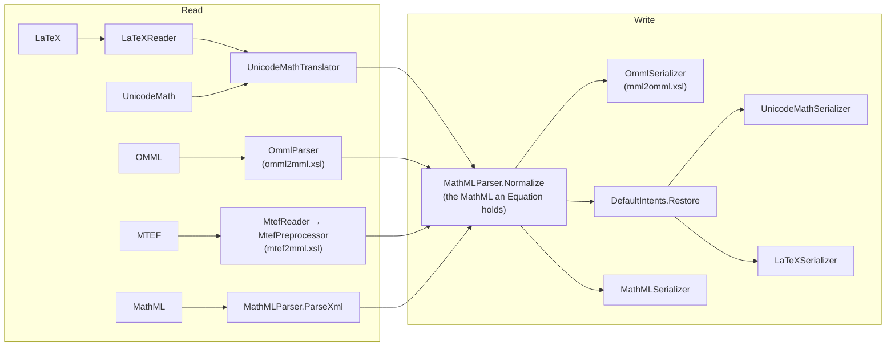
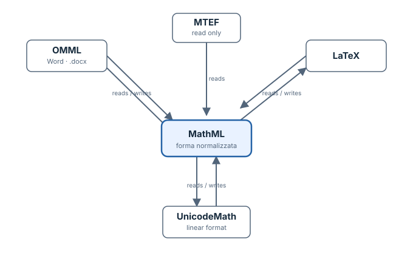

# Architecture

SharpEquations reads an equation in one format and writes it in another, always through presentation MathML. This
document describes how: the public API, the pipeline every conversion takes, the normalized MathML an equation holds,
each format, and how round trips are kept exact. `AGENTS.md` has the short version and the rules for contributors.

## The idea: one representation

The same architecture is also shown as a standalone SVG below. The Mermaid diagram keeps the implementation stages
visible; the SVG gives a compact view of the format relationships. Both describe the same pipeline: each supported
reader produces MathML, normalization establishes the representation held by `Equation`, and the writers serialize
that normalized tree. MTEF has no writer.

### What round trips preserve

Normalization deliberately removes differences that do not change the represented equation, such as default
formatting and redundant grouping. A target format may not be able to express every MathML feature, so conversion
to that format can lose information. Once the result is parsed again, the normalized equation is stable: repeating
the same conversion does not introduce further changes. Exact round trips are guaranteed for UnicodeMath and for
OMML written by this library; the other formats preserve the information they can represent. MTEF is read only.

Every reader produces MathML, and `MathMLParser.Normalize` brings it to a single canonical form. Every writer starts
from that form. With five formats this needs five readers and four writers (MTEF is read only), instead of a
converter for each pair of formats. It also means that two equations are equal when their normalized MathML is the
same string.

## Public API (`src/SharpEquations/Public/`)

| Type | Role |
|---|---|
| `Equation` | An immutable equation: its normalized MathML. `Parse`/`TryParse` from a string, an `XElement` (MathML, OMML) or bytes (MTEF); `ToMathML()`, `ToOmml()`, `ToString(EquationFormat, EquationOptions?)` and `IFormattable` (`$"{equation:L}"`); `IsDisplay`/`WithDisplay`. Equal when the MathML is equal (`IEquatable`, `==`). |
| `EquationConverter` | `Convert`/`TryConvert` between two formats in one call, `CanRead`/`CanWrite`. |
| `EquationFormat` | `MathML`, `Omml`, `Mtef`, `UnicodeMath`, `LaTeX`. |
| `EquationOptions` | An init-only record: `Display` (for UnicodeMath and LaTeX without delimiters), `Strict` (unknown commands and elements are errors), `PreserveFormatting` (colours, sizes, fonts), `LaTeXFlavor` (`Standard` or `Word`), `LaTeXMacros`. |
| `LaTeXFlavor` | `Standard`: LaTeX that LaTeX, MathJax and KaTeX read. `Word`: the LaTeX of Word's equation editor, closer to UnicodeMath. |
| `MathMLNamespaces` | The MathML, OMML and WordprocessingML namespaces. |

Everything else is `internal`, under `src/SharpEquations/Internal/`, in one folder per format. The tests reach the
internals through `InternalsVisibleTo`.

## The pipeline (`Internal/EquationPipeline.cs`, `Internal/EquationSerializer.cs`)

`EquationPipeline.Read` matches the format against the kind of source (`string`, `XElement`, `byte[]`) and calls the
parser of that format; a source of the wrong kind (MTEF as text, LaTeX as XML) is an `ArgumentException`. Its result
always goes through `MathMLParser.Normalize`. A source that is not valid in its format is a `FormatException`,
whatever exception the parser raised inside.

`EquationSerializer.Serialize` picks the writer. MathML and OMML come out as `XElement`, the other formats as strings.

UnicodeMath and LaTeX parsing honour a `CancellationToken`, since their grammars can take long on pathological input.
The XSLT stylesheets recurse over the tree, and a stack overflow ends the process without an exception that can be
caught, so `EquationStylesheets` rejects input nested more than 512 levels deep (`MaxDepth`). The MTEF reader stops at
256 nested record lists for the same reason.

## The stylesheets compiled to C# (`src/SharpEquations.XsltGenerator/`, `Internal/Xslt/`)

The three XSLT 1.0 stylesheets of `Resources/` (`omml2mml.xsl`, `mml2omml.xsl`, `mtef2mml.xsl`) are compiled to C# at
build time by `SharpEquations.XsltGenerator`, a source generator that reads them as additional files. Nothing is
generated at run time, unlike `XslCompiledTransform`, which emits IL: so the library runs under Native AOT, and the
stylesheets are not embedded in it.

- Each stylesheet becomes a class named after its file (`Omml2mmlStylesheet`), declared partial in
  `Internal/Xslt/Stylesheets.cs`, with a method for each template, a lazy property for each global variable and, for
  each mode, the dispatch of `xsl:apply-templates`: by the name of the element first, then the rules in the order of
  XSLT (highest priority, then the last in the stylesheet), then the built-in templates.
- Each XPath expression becomes a C# expression over `XPathFunctions` (the data model of XPath over LINQ to XML, its
  functions and conversions). Its type is known when it can be (a string, a number, a boolean, a node-set, a result
  tree fragment), and is `object` otherwise (a parameter).
- `XsltOutput` builds the result as LINQ to XML, as `XslCompiledTransform` gave it when its output was written as text
  and parsed again: text written with `disable-output-escaping` is markup, with the text next to it (`mtef2mml.xsl`
  writes character references in pieces), and empty text leaves `<t></t>` rather than `<t />`.
- Strings are counted, cut and translated by code points, as XPath defines them (`XslCompiledTransform` counted UTF-16
  units).
- What the stylesheets do not use (keys, `xsl:sort`, `xsl:number`, imports, extension functions, the `following` and
  `preceding` axes) is an error of the build (XSLT001).

`Xslt/CompiledStylesheetTests` checks that the compiled stylesheets give what `XslCompiledTransform` gives for the
corpora: the OMML of Word documents and of the UnicodeMathML examples, their MathML, and the MTEF of the test data. It
leaves out the inputs with characters outside the basic plane, where the two count differently.

## The normalized MathML (`Internal/MathML/MathMLParser.cs`)

`Normalize` is what makes equality and round trips possible. The same mathematics read from different formats, or
written differently in one format, must give the same MathML. It applies, in order:

- **Namespace:** the MathML namespace as the default one, no prefixes (`m:mi` becomes `mi`). A link (`a`, from
  UnicodeMath `\href`) becomes an `mrow`.
- **Fences:**
  - `mfenced` is rewritten as an `mrow` with `mo` fences;
  - invisible fences (UnicodeMath `〖〗`, LaTeX `{}` before a script) only group, so they become a plain `mrow`.
- **Formatting:** dropped unless `PreserveFormatting` is set, so that a red `x` and a black `x` are the same
  equation.
- **Characters:**
  - the division slash `∕` becomes `/`;
  - an operator hyphen `-` becomes the minus sign `−`;
  - infinity becomes an identifier;
  - comments and editor selection attributes are removed;
  - adjacent plain `mtext` are merged.
- **Letters as MathML Core writes them:**
  - `<mi>x</mi>` for an italic letter;
  - `𝐲` (a mathematical alphanumeric) rather than `mathvariant="bold"`;
  - a plain letter with `mathvariant="normal"` for an upright one.
- **Underbars:** an underbar is `menclose notation="bottom"`, whether it came from OMML's `m:bar`, UnicodeMath `▁` or
  LaTeX `\underline`.
- **Accents:** `accent="false"` on a script that is not an accent anyway is removed, and so is `stretchy="true"` on an
  operator that stretches by default.
- **Default intents removed:** see the next section.
- **Redundant rows:** an `mrow` that groups nothing more than its parent is removed.

### Default intents (`Internal/MathML/DefaultIntents.cs`)

UnicodeMath, and LaTeX read through it, annotate structure with MathML `intent` attributes:
- `:fenced`, `:function`, `:largeop`;
- `absolute-value`, `binomial-coefficient`, `cardinality`, the intervals;
- the matrices (`:parenthesized-matrix`, `:bracketed-matrix`, …), `:system-of-equations`, `:piecewise`;
- `derivative` and others.

These intents only restate what the structure already says. They also depend on how the equation was written: a
binomial written `\binom{n}{k}`, `𝑛⒞𝑘` or `(𝑛¦𝑘)` gave three different MathML trees, and OMML cannot hold intents at
all. So `Normalize` removes them, together with the argument names (`arg`) that no remaining intent refers to.

It keeps the intents that carry information the structure does not:
- `:text` (an escaped character);
- the double-struck letters `ⅆ`, `ⅈ`, `ⅇ`;
- `transpose`;
- equation labels and math paragraphs;
- any intent the author gave explicitly (UnicodeMath `ⓘ`).

The writers that use intents call `DefaultIntents.Restore` first. It works on a copy, infers the default intents
again from the structure (fences, the bar of a fraction, the brackets around a table) and marks them as restored. It
also regroups an n-ary operation or a function application that normalization flattened into its parent.

## The formats

### MathML (`Internal/MathML/`)

`ParseXml` reads the XML with DTDs prohibited and no resolver (no external entities), the undeclared prefixes `mml:`, `m:` and `w:` known; in strict mode `Validate` accepts presentation MathML only.
`MathMLSerializer` writes the normalized MathML as it is.

### OMML (`Internal/Omml/`)

OMML ↔ MathML uses the XSLT 1.0 stylesheets of the TEI Consortium (`Resources/omml2mml.xsl`, `Resources/mml2omml.xsl`,
BSD-2-Clause), the descendants of the ones Microsoft ships with Office, compiled to C# at build time (see "The
stylesheets compiled to C#" below). C# code before and after each stylesheet fixes what the stylesheets get wrong or
what Word writes differently.

**Reading (`OmmlParser`):**
- `m:oMathPara` is a display equation, `m:oMath` an inline one.
- `ST_OnOff` values are normalized, because the stylesheet only knows `on`/`off`.
- Characters outside the basic plane go through the stylesheet as private use characters, because
  `XslCompiledTransform`, which ran it before it was compiled to C#, split text into UTF-16 units.
- Lines aligned with `m:aln` become a table marked as aligned lines.
- Numbers split across runs are joined.
- Word's equation numbers (`#(1)`) become `mlabeledtr`.
- An upright word (`max`) becomes one identifier.
- Space-only tokens become `mtext`.
- In strict mode, `Validate` rejects elements that are not OMML.

**Writing (`OmmlSerializer`), as Word writes it:**
- Plain letters get `m:sty`/`m:scr` instead of mathematical alphanumerics, and an underbar becomes `m:bar`.
- Accents are combining characters.
- An empty `begChr`/`endChr`/`sepChr` is kept, because it means "no delimiter".
- Fenced rows become `m:d`, inner rows first so that nested delimiters survive (`FenceRow`).
- A comma or point between numbers gets its own run, so it does not join them.
- An n-ary operator without limits stays an `m:nary`.
- Children are reordered as the schema requires.
- Aligned lines become one `m:oMath` per line with `m:aln`.

### MTEF (`Internal/Mtef/`, read only)

MTEF is the binary format of Equation Editor 3.0 (MTEF 3) and MathType (MTEF 5) OLE objects. The conversion is a C#
port of the jure/mathtype gem and of jure/mathtype_to_mathml (MIT):

1. `MtefReader` reads the records into the XML the gem writes: one element per record, named after the record,
   holding its fields.
2. `MtefPreprocessor` does what the Mover and CharReplacer classes do:
   - moves each script into its base, since MTEF scripts follow their base and MathML scripts contain it;
   - wraps embellished characters;
   - replaces characters in ranges that XSLT 1.0 cannot test;
   - adds to MTEF 3 the options that only MTEF 5 records carry (`TemplateVariations3/5`).
3. `Resources/mtef2mml.xsl`, the gem's stylesheets merged into one file, writes the MathML.

`MtefParser.Parse` takes the MTEF bytes, either bare or with the 28-byte `EQNOLEFILEHDR` header of an "Equation
Native" stream. Opening the OLE compound file is the caller's job, so the library needs no OLE reader. The test
fixtures are the extracted streams (`tests/data/mtef/**/*.eqn`).

### UnicodeMath (`Internal/UnicodeMath/`)

UnicodeMath is the linear format of Word's equation editor ([Unicode Technical Note 28](https://www.unicode.org/notes/tn28/)). The reader and the writer are
ports of UnicodeMathML (MIT).

**Reading (`UnicodeMathParser` → `UnicodeMathTranslator`), in UnicodeMathML's steps:**

1. **Control words:** `UnicodeMathInput.ResolveControlWords` replaces `\alpha` with `α` and `\sqrt` with `√`. Unknown
   control words stay as text, or are errors in strict mode. Macros (`\def`, `\newcommand`, held as `ⓜ`) are
   expanded in the equation that defines them.
2. **Set-builder bars:** `SetBuilderBars` turns the bar of `{𝑥|𝑥>0}` into the separator `│`.
3. **Grammar:** a PEG grammar, `UnicodeMathGrammar.parlot.cs`.
   - Parlot.SourceGenerator compiles it at build time; the generated parser goes to `obj/`, never to the repository.
   - Parlot has no memoization, so alternatives that share a prefix are written to parse the prefix once.
   - The generator compiles the whole project, so any C# error in the project shows as `PARLOT001`.
   - Parlot parses `char`s, so `MapToPrivate` first maps characters outside the basic plane to the private use area,
     and the syntax tree maps them back.
4. **Preprocess, transform, pretty:** the JavaScript of UnicodeMathML (`UnicodeMathPreprocess`,
   `UnicodeMathTransform`, `UnicodeMathPretty`), ported line by line over `JsObject`.
   - `JsObject` is a dictionary that keeps insertion order and reads a missing key as `undefined`.
   - The `Js` helpers mimic JavaScript truthiness, equality and string functions.
   - Where the JavaScript indexes strings by UTF-16 units, the port indexes by code points (`Js.Ch`, `Js.Len`,
     `Js.Sub`).
5. **Errors:** the port assumes the structures its grammar gives, so an unexpected structure that surfaces as a
   `NullReferenceException` or a similar exception is reported as a `FormatException`.

**Writing (`UnicodeMathSerializer`, a port of UnicodeMathML's `dump`):**
- **Self-correcting loop:** the writer checks what it writes by reading it back:
  1. write the UnicodeMath;
  2. read it back and normalize it;
  3. compare it with the source (`FindLostIntents`).
  - It then writes what was lost:
    - a non-default intent as `ⓘ("…"…)`;
    - an argument name as `ⓐ(name …)`;
    - an operator that read back as an identifier as `ⓡ(X&U+XXXX)`.
  - At most three passes.
- **`Role`:** infers the structural role of a row (function application, large operator, fenced content, system of
  equations, piecewise function). The writer needs it even when the equation holds no intent.
- **Other choices:**
  - n-ary limits use `┬`/`┴` and the options digit (`∑1`);
  - a scripted base is grouped in `〖〗`;
  - sized fences use `├n`;
  - a bevelled fraction uses `⁄`, a plain slash `∕`;
  - spaces are added only where reading needs them.

### LaTeX (`Internal/LaTeX/`)

**Reading:** LaTeX is read as Word reads it, by rewriting it as UnicodeMath (`LaTeXReader`, a port of UnicodeMathML's
`TeX2UnicodeMath`) and parsing that.
- **Rewrite pass (`RewriteTeXOnly`):** handles the commands that UnicodeMath has no control word for, and the places
  where LaTeX means something different from UnicodeMath:
  - `\overset`, `\underset` and `\stackrel` become `┴`/`┬`, and a combining mark as their script becomes the accent of
    its base;
  - `\genfrac`, `\color`, `\colorbox`, `\pmod`, `\xrightarrow`, `\mathop`, `\operatorname` and `\hspace` are rewritten;
  - a LaTeX slash is a slash (`\/` in UnicodeMath), not a fraction;
  - a bar inside `⟨…⟩` is the bra-ket separator `│`, unless no `⟩` follows (a bra alone keeps its bar);
  - a combining mark written after its base is held aside, because the next pass treats the marks of `\vec` and
    similar commands as prefixes.
- **`EscapeOddBars`:** a `|` without its pair is escaped, because in UnicodeMath a bar opens an absolute value.
- **Pass 1:** replaces commands with UnicodeMath characters (`\frac` becomes `⍁`, `\begin` becomes `〖`, `\alpha`
  becomes `α`).
- **Macro pass:** defines and applies `\def` and `\newcommand`.
- **Pass 2 (`Pass2`):** turns the result into UnicodeMath syntax:
  - arguments are grouped;
  - a script that has scripts of its own is parenthesized (`a_{3_4}`);
  - a base with scripts under `\underset` is grouped;
  - parentheses inside a script are kept (`f^{(2)}`);
  - `\sqrt[…]` is handled with its index;
  - environments become UnicodeMath matrices.
- **Retry on failure:** if the UnicodeMath does not parse, the reader tries once more with unpaired closing brackets
  escaped (`EscapeUnpairedClosers`). This covers `v\rfloor B` and a lone `)`, which LaTeX accepts and UnicodeMath does
  not.

**Writing (`LaTeXSerializer`, a port of UnicodeMathML's `TeX`, on the restored intents), in two flavors:**
- **Standard:**
  - `\frac`, `\binom`, `\genfrac`;
  - environments from the matrix intents: `pmatrix`, `bmatrix`, `Bmatrix`, `vmatrix`, `Vmatrix`, `cases`, `aligned`;
  - `\left`/`\right` only around tall content or fences that do not pair;
  - `|x|` plain unless it is tall or nested;
  - `\operatorname` for names that are not functions, with `\underset` when their limits go below;
  - a command is left unbraced as a base (`\mathbb{R}^n`) but braced as a script (`x_{\text{ab}}`), because LaTeX
    takes only the next token as a script;
  - upright Greek letters as text;
  - UnicodeMath structure operators that stand alone are escaped (`\▭`).
- **Word:**
  - the LaTeX of Word's editor: letters as mathematical alphanumerics, `\abs`, `\card`;
  - Unicode primes;
  - `\{ \}` for braces;
  - brackets and bars that pair with nothing are written bare, and the reader escapes them;
  - `\left`/`\right` for fences that do not pair.

  Word's LaTeX goes through the same reader.

`LaTeXSymbols` maps characters to commands and back (`α` ↔ `\alpha`, `𝐱` ↔ `\mathbf{x}`) and tidies spaces after
commands.

## Text as code points (`Internal/Text/CodePoints.cs`)

Equations are full of characters outside the basic plane, such as mathematical alphanumerics (`𝑥`, `𝔸`) and emoji. All
text is handled as Unicode scalar values (`System.Text.Rune`), never as UTF-16 `char`s. On .NET Standard 2.0, which has
no `Rune`, the library carries an internal one (`Internal/Text/Rune.cs`) with the same behavior: it is not visible to
the consumers, so it meets no `Rune` of their framework. A lone surrogate reads as U+FFFD.

## Round trips and how they are tested

The guarantee is:
- **Same format:** an equation written in its own format reads back to the same equation. This holds for
  UnicodeMath, and for the OMML of Word documents.
- **Other formats:** an equation written in another format loses only what that format cannot hold, and only the
  first time. Once read back, it is stable (standard LaTeX, Word's LaTeX, OMML of any origin).

`tests/SharpEquations.Tests/Property/RoundTripPropertyTests.cs` checks this on two sets: the 738 examples of the
UnicodeMathML corpus (`tests/data/unicodemath/`, every construct UnicodeMath has) and 192 equations saved by Word
(`tests/data/omml/`). It also checks the following:
- **MathML:** reads back to the same equation.
- **Writing:** never throws.
- **Strict OMML:** accepts what the OMML writer writes.
- **Reading:** is deterministic.

These must stay at 100%.

The other tests are in folders by subject:
- `PublicApi`, `MathML`, `Omml`, `Mtef`, `UnicodeMath`, `LaTeX` and `Regression`;
- in `Property`, next to the round-trip tests, truncated input that must fail cleanly.

They compare against the outputs the UnicodeMathML authors expect, and list explicitly the few places where
SharpEquations deliberately writes something else. They use TUnit. They run on .NET 10 against the .NET 10 build, and
on .NET 8 against the .NET Standard 2.0 build, so both builds of the library are tested.

## Adding a format

1. Add the value to `EquationFormat` and the reader and writer to `EquationPipeline` and `EquationSerializer`.
2. Put the code in `Internal/<Format>/`. The reader produces MathML in any reasonable form, because `Normalize` does
   the rest. The writer starts from normalized MathML, plus `DefaultIntents.Restore` if it needs the roles of rows.
3. Add the format to the round-trip property tests, and make them pass on the whole corpus before merging.
