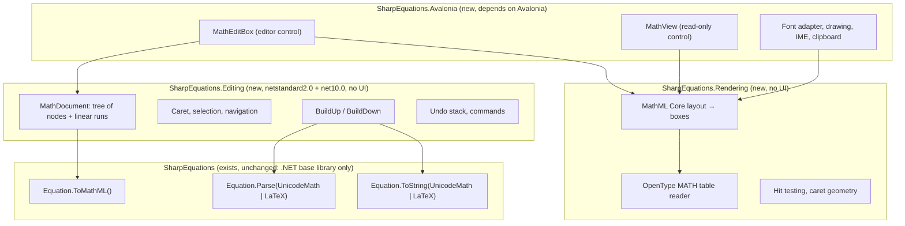

# Equation editor for Avalonia (design)

A design for `MathEditBox`, a real-time equation editor for Avalonia in the manner of the `RichEditBox` of WinUI in
`RichEditMathMode.MathOnly`: the user types UnicodeMath or LaTeX, the equation builds up into its two-dimensional form
as it is typed, and the content is read and written as MathML (`GetMath`/`SetMath` in WinUI). SharpEquations is the
core under it: it reads what is typed, gives the MathML, and writes the linear form back when a part of the equation
is built down. This document is a proposal: nothing of it exists yet.

## What the user sees

The behaviour is the one of the math zones of Word and of `RichEditBox` in math mode.

- **Professional** (built up): the equation is shown in two dimensions. Typing goes into the *linear run* at the caret,
  a piece of plain text; when a character that ends an argument is typed (space, an operator, `)`, `]`, Enter, Tab) the
  run is *built up*: `a/b␣` becomes a fraction, `x^2␣` a superscript, `\alpha␣` becomes `α`, `\sqrt(x)` a radical.
  Text that does not parse yet (`a/`) stays linear, drawn as typed, until it does.
- **Linear**: the whole equation (or the selection) is shown as one line of UnicodeMath or LaTeX and edited as text.
  The switch (Ctrl+Shift+=, as Word has it, or a property) builds down to linear and up to professional.
- **Input format**: UnicodeMath or LaTeX (`InputFormat`); LaTeX is read as Word reads it, which is what SharpEquations
  already does (`LaTeXReader`), and written back, when built down, in the LaTeX of Word (`LaTeXFlavor.Word`).
- **Navigation** in two dimensions: the arrows move through the slots of the structures (numerator → denominator,
  base → script, the cells of a matrix), Home/End to the ends of the current row, Backspace into a structure *selects*
  it first and deletes it the second time (as Word), Ctrl+Z/Ctrl+Y undo and redo.
- **Clipboard**: copy puts MathML (`application/mathml+xml`), UnicodeMath or LaTeX (as plain text, in the input format)
  and OMML on the clipboard; paste reads any of them through `Equation.Parse`.
- **Autocomplete**: after `\` a list of control words (`\alpha`, `\int`, `\matrix`...) with their symbols.

## Layers



The core stays as it is: the rules of `AGENTS.md` (no dependencies but the base library, no change of the public API
without a reason that is the owner's) hold for it, and the editor is built on its public API. The two middle layers
have no UI dependency, so that they are tested with TUnit like the core and could serve another toolkit (WPF, MAUI,
Uno) later; only the last depends on Avalonia.

| Project | Target | Depends on |
|---|---|---|
| `src/SharpEquations.Editing/` | netstandard2.0, net10.0 | SharpEquations |
| `src/SharpEquations.Rendering/` | netstandard2.0, net10.0 | SharpEquations.Editing (for the node tree) |
| `src/SharpEquations.Avalonia/` | net8.0, net10.0 | SharpEquations.Rendering, Avalonia 11 |
| `samples/SharpEquations.Avalonia.Demo/` | net10.0 | SharpEquations.Avalonia, Avalonia.Desktop |
| `tests/SharpEquations.Editing.Tests/` | as the core tests | TUnit, Avalonia.Headless for the control |

They ship as separate packages, so that who uses only the converter does not get Avalonia.

## The document model (`SharpEquations.Editing`)

### Why a tree and not a string

The obvious design keeps the linear text as the source of truth and parses all of it at each keystroke. It does not
work for an editor in two dimensions: the caret is in the rendered equation, and mapping it to an offset in the text
needs the source span of every node, which no parser of SharpEquations gives (the UnicodeMath translator, ported line
by line, has no notion of spans). The model is therefore the one of Word: a tree of built-up objects in which the only
text is the *linear runs* at the caret, and parsing is limited to what is being built up.

```csharp
abstract class MathNode            // immutable; a change gives a new tree (cheap undo, safe rendering)
sealed class MathRow : MathNode    // a sequence: the slot of every structure; the caret lives here
sealed class MathToken : MathNode  // mi, mn, mo, mtext, ms: one atom of the row, with its attributes
sealed class MathRun : MathNode    // linear text not built up yet, drawn as typed
sealed class MathScript : MathNode // msub, msup, msubsup, munder, mover, munderover, mmultiscripts
sealed class MathFraction, MathRadical, MathEnclose, MathTable, MathStyle, MathPadded, MathPhantom, MathSpace ...
```

The nodes are the elements of the normalized MathML of `MathMLParser.Normalize`, which is a small set (MathML Core
plus `menclose`, `mlabeledtr`, `ms`, `mstack`/`mlongdiv` read as they are); each knows its *slots*, the children that
are rows the caret can enter (both children of `mfrac`, the base and the scripts of `msubsup`, each `mtd`). A node that
is not a row is wrapped in a row when it is a slot, so that the caret always has a row to stand in.

- `MathDocument.FromMathML(XElement)`: the normalized MathML (`Equation.Parse(...).ToMathML()`) to nodes.
- `MathDocument.ToMathML()`: nodes to MathML; the runs are built up on the way (a run that does not parse is written as
  `merror` with its text, or, with an option, as `mtext`), and the result goes through `Equation.Parse(xml, MathML)`
  so that it is normalized like any other equation and `Equation` equality works on what the editor gives.
- `MathDocument.Equation`: the `Equation` of the content, the value a binding of the control sees.

### Caret and selection

A caret is a path of slots from the root plus an offset in a row (between two children) or in a run (between two code
points, never two UTF-16 `char`s, as everywhere in SharpEquations). A selection is two carets in the same row (a range
of siblings); extending it out of a row selects the whole structure the row belongs to, as Word does. Navigation is a
table per node kind (which slot is *up*, *down*, *next* and *previous* of which), kept out of the layout: the geometry
is the renderer's, and only *up*/*down* inside a table or a stack ask the layout for the nearest x.

### Build up

When a character that ends an argument is typed in a run (the list is the one of UnicodeMath, *Unicode Technical Note
28*, §3.5: space, operators, closing brackets, `&`, `@`, Enter), `BuildUp` takes:

1. the *argument* before the caret: the run, together with the siblings before it in the row back to the start of the
   row or to an operator of lower precedence, since `(a+b)/c` makes a fraction of a bracket already built up;
2. the linear text of those siblings, with `Equation.ToString(UnicodeMath)` (or `LaTeX`, `LaTeXFlavor.Word`) on the
   MathML of each; this is exact because UnicodeMath round-trips exactly (`RoundTripPropertyTests`, kept at 100%):
   building down and up again gives the same nodes;
3. `Equation.TryParse` of the text in the input format; if it fails the run stays as it is, and nothing is lost;
4. the nodes of the result replace the siblings and the run, and the caret goes after them, in a new empty run if the
   character typed was a space (which is consumed, as in Word) or after the operator otherwise.

`BuildDown` is the opposite: a node (the one at the caret, the selection, or the whole equation for the linear view)
becomes one run with its linear text. Both are commands on the undo stack, so Ctrl+Z after a build-up gives back the
text as it was typed, as in Word.

Parsing is synchronous: the run is a few characters, and an equation built down whole is the size of the examples of
`tests/data/unicodemath/`; `benchmarks/` gets a case for it so that the time per keystroke is measured, not assumed.

### Autocorrect and autocomplete

`\alpha␣` → `α` comes from the parser (a control word followed by a space). The list for the autocomplete popup is the
table of `Internal/UnicodeMath/ControlWords.cs` and `Internal/LaTeX/LaTeXSymbols.cs`, which are internal; see *Open
questions*.

## Layout and rendering (`SharpEquations.Rendering`)

Rendering MathML well is the largest piece of work and the one with no shortcut in Avalonia: CSharpMath.Avalonia
renders LaTeX with its own model, not MathML, and would mean a second representation to keep in step with the first.
The renderer is therefore a MathML Core layout over the OpenType `MATH` table, as browsers implement it.

- **Fonts**: a math font with a `MATH` table, by default Latin Modern Math or STIX Two Math (both SIL OFL, embeddable
  as an Avalonia resource; the license goes in `NOTICE`). The table (constants, italic corrections, top accent
  attachment, glyph variants and assemblies for stretchy operators) is read from the font bytes, which Avalonia gives
  with `IGlyphTypeface.TryGetTable`.
- **Layout**: an abstract `IMathFont` (advances, bounds, the `MATH` table, shaping of a run) and a layout that turns the
  node tree into boxes (width, ascent, descent, italic correction) following MathML Core §3: tokens, `mrow` with the
  spacing of the operator dictionary (`lspace`/`rspace`, `form` from the position), stretchy operators (brackets to the
  height of their row, `∑` large in display), `mfrac`, `msqrt`/`mroot`, scripts and limits, `mtable`, `menclose`,
  `mpadded`, `mspace`, display and inline style (`displaystyle`, `scriptlevel`).
- **Editing geometry**: every box keeps the node and slot it comes from, so that the renderer answers the editor's
  questions: the rectangle of a caret, the node and offset at a point (hit testing for clicks and drags), the outline
  of a selection. Empty slots are drawn as a dotted box (the placeholder `⬚` of Word).
- **Incremental**: the tree is immutable, so the layout of a subtree that did not change is reused (a cache keyed by
  node identity and style); a keystroke lays out again only the path from the edited row to the root.

## The Avalonia control (`SharpEquations.Avalonia`)

```csharp
public class MathEditBox : TemplatedControl
{
    public static readonly StyledProperty<Equation?> EquationProperty;         // two-way; the content as an Equation
    public static readonly StyledProperty<EquationFormat> InputFormatProperty; // UnicodeMath (default) or LaTeX
    public static readonly StyledProperty<MathViewMode> ViewModeProperty;      // Professional or Linear
    public static readonly StyledProperty<bool> IsDisplayProperty;             // display or inline style
    public static readonly StyledProperty<bool> IsReadOnlyProperty;
    public static readonly StyledProperty<FontFamily> MathFontFamilyProperty;
    public static readonly StyledProperty<double> FontSizeProperty;

    public string GetMath();                // MathML, as RichEditTextDocument.GetMath
    public void SetMath(string mathML);     // as RichEditTextDocument.SetMath
    public string GetText(EquationFormat format);
    public void BuildUp(); public void BuildDown();
    public event EventHandler<EquationChangedEventArgs>? EquationChanged;
}

public class MathView : Control             // read-only: Equation or MathML in, drawing out
```

- Text input through `TextInput` and an `ITextInputMethodClient`, so that IMEs and dead keys work and the candidate
  window is placed at the caret (Avalonia 11 `TextInputMethodClient`).
- Key bindings as `KeyBinding`s of commands (`MathEditCommands.BuildUp`, `ToggleLinear`...), so that an application
  changes them; the defaults are those of Word.
- Accessibility: an `AutomationPeer` that exposes the value as UnicodeMath text (what Narrator and NVDA read in Word),
  and the MathML for the readers that speak it.
- Theming: colours from the theme resources (foreground, selection, placeholder), a template with a `ScrollViewer` for
  long equations, and the linear view as a `TextBox` part of the template.
- The `EquationProperty` is set on every build-up, not on every keystroke inside a run, so that a binding sees only
  equations that parse; `GetMath()` builds up the runs as `ToMathML()` does.

## Plan

| Phase | Content | Done when |
|---|---|---|
| 1 | `SharpEquations.Rendering` with `MathView`: `MATH` table, layout of tokens, rows, fractions, scripts, radicals, brackets | the examples of `tests/data/unicodemath/` render without exceptions, screenshot tests of a set of them against reference images |
| 2 | `SharpEquations.Editing`: nodes ↔ MathML, caret, navigation, `BuildUp`/`BuildDown`, undo | the property test *build down then build up gives the same nodes* for all the examples; typing an example one character at a time gives its equation |
| 3 | `MathEditBox`: input, caret drawing, hit testing, selection, linear view, clipboard | headless tests (Avalonia.Headless) of typing, navigation and clipboard; the demo |
| 4 | Tables and matrices, `menclose`, accents, `mmultiscripts`, autocomplete, accessibility, IME | the rest of the normalized MathML renders; Narrator reads an equation |

Phase 1 first, because it is useful alone (showing MathML in Avalonia is something people need without editing) and
because the editor cannot be judged without it.

## Open questions

These are the owner's to decide.

1. **Repository**: the three projects in this repository (one solution, one CI, the core tested with them) or in a new
   one (`SharpEquations.Avalonia`)? This document assumes this one, with separate packages and a version of their own.
2. **Public API of the core** for the editor; none is needed for phases 1–3, but these would help:
   - the list of control words and LaTeX commands with their symbols (`ControlWords`, `LaTeXSymbols`) for autocomplete;
   - parsing a *fragment* to MathML without the `math` element and the normalization of a whole equation, if the
     build-up of an argument needs it (to be seen in phase 2: wrapping the fragment in an equation may be enough);
   - the operator dictionary (`form`, `lspace`, `rspace`, `stretchy`, `largeop`) if the core has or gets one, so that
     the layout does not keep a second copy.
3. **Default font**: Latin Modern Math (the look of LaTeX) or STIX Two Math (closer to Cambria Math of Word)?
4. **Inline equations in text**: is the goal a control for one equation (as `RichEditMathMode.MathOnly`), or also math
   zones inside a text document (as Word and `RichEditBox` without `MathOnly`)? The design is for the first; the second
   is a rich text editor of its own, which Avalonia does not have.
