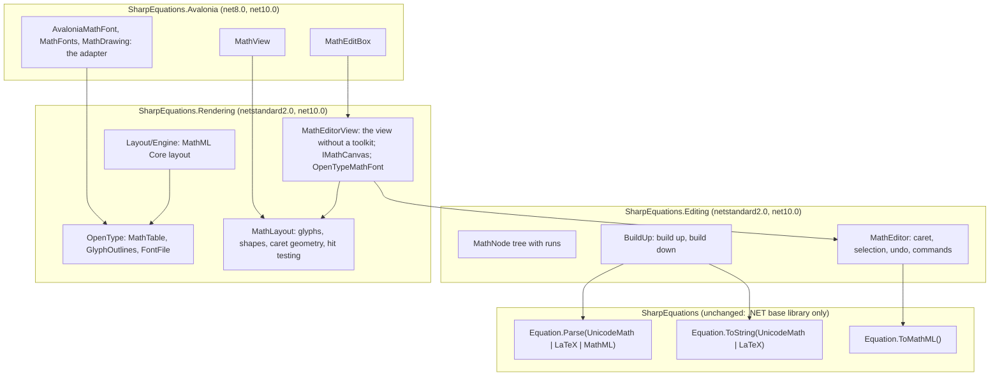

# Equation editor for Avalonia

`MathEditBox` is a real-time equation editor for Avalonia in the manner of the `RichEditBox` of WinUI in
`RichEditMathMode.MathOnly`: the user types UnicodeMath or LaTeX, the equation builds up into its two-dimensional form
as it is typed, and the content is read and written as MathML (`GetMath`/`SetMath`, as in WinUI) or as an `Equation`.
SharpEquations is the core under it: it reads what is typed, gives the MathML, and writes the linear form back when a
part of the equation is built down. The editor edits one equation (math only), not math zones in a text document.

Phases 1 to 6 of the plan below are done; the three projects are published as NuGet packages with
the version of the core.

## What the user sees

The behaviour is the one of the equations of Word and of `RichEditBox` in math mode.

- **Professional** (built up): the equation is shown in two dimensions. Typing goes into the *run* at the caret, a
  piece of linear text; when a character that ends an argument is typed (a space, or an operator: `+ - = < > , ; :`,
  `± × · ÷`, the relations and arrows) the run is *built up*: `a/b␣` becomes a fraction, `x^2+` a superscript and a
  plus, `\alpha␣` becomes `α`, `\sqrt(x)␣` a radical. The space that builds up is not kept. Text that does not parse
  yet, or that is not finished (an open bracket or quote, an operator right after `^ _ / \ (`, as in `e^-x`), stays
  linear, drawn as typed, until it does.
- **Linear**: the whole equation is shown as one run of UnicodeMath or LaTeX and edited as text
  (`ViewMode = MathViewMode.Linear`, or Ctrl+Shift+L, `ToggleViewModeGesture`). Switching back builds it up.
- **Input format**: `InputFormat` is UnicodeMath or LaTeX; LaTeX is read as Word reads it (`LaTeXReader`) and written,
  when built down, as the LaTeX of Word (`LaTeXFlavor.Word`).
- **Navigation**: Left and Right go through the slots of the structures (numerator, denominator, base, scripts, the
  index of a root before its base, the cells of a table); Up and Down go to the slot above or below (numerator and
  denominator, superscript and subscript, limits, the rows of a table), to the position nearest to the caret; Home and
  End go to the ends of the row, then of the equation; Shift extends the selection, which covers a whole structure when
  it leaves a slot. Backspace and Delete remove a code point of a run or of a token (a token becomes a run then), and
  select a structure first and delete it the second time, as in Word. Ctrl+Z and Ctrl+Y undo and redo: the history is a
  stack of the immutable trees (1000 at most, `UndoLimit`), which share what an edit did not change; the characters
  typed in a row are one step, and a build up another, so that an undo after a build up gives back the text as it was
  typed; Ctrl+A selects all; Enter builds up all the runs. The shortcuts of copy,
  paste, undo... are those of the platform (`PlatformHotkeyConfiguration`).
- **Context menu**: right click, a long press on touch, the Menu key or Shift+F10 open it (under the caret from the
  keyboard): undo, redo, cut, copy, paste, *copy as* MathML, UnicodeMath, LaTeX or OMML (the selection, or the whole
  equation: `CopyAsAsync`), select all, linear or professional, build up and down, new line, the number of the
  equation, and the rows and columns of the table of the caret. A right click outside the selection moves the caret
  there first; a read-only editor has only the copy commands and select all. An application changes it in
  `ContextMenuOpening` (its items have a tag that names their command), overrides `CreateContextMenu`, or turns it off
  with `IsContextMenuEnabled`.
- **Mouse**: a click places the caret at the nearest position of the deepest row under the pointer; a drag selects.
- **Clipboard**: copy puts the selection as text in `CopyTextFormat` (the input format by default; MathML pastes as an
  equation into Word) and as MathML (`MathML` on Windows, `application/mathml+xml` elsewhere), as UTF-8 bytes, as Word writes and reads
  that format (`MathClipboard` decodes UTF-8, or UTF-16 with its byte order mark); a handler of `Copying`
  can add formats or cancel; `GetSelectedText(format)` gives the selection in any format (UnicodeMath, LaTeX, MathML,
  OMML) without the clipboard. Paste reads MathML, then the text in the input format or as MathML, and inserts plain
  text as a run when it does not parse; MathML that does not parse inserts nothing.
- **Input**: one format at a time, UnicodeMath or LaTeX, switched at any moment (what is built up stays). UnicodeMath
  already reads the TeX control words of Word (`\alpha`, `\sqrt`, `\sum`); a LaTeX control word followed by a space
  waits for its argument when it has one (`\mathring a`), and is built up when it is complete (`\alpha␣`).
- **Equation numbers**: `#(1)` at the end in UnicodeMath, `\tag{1}` in LaTeX, or `EquationNumber = "(1)"`: the number
  goes to the right edge of the line (or the left, with `side="left"`), with the equation in the middle of what is
  left, as in Word; the layout knows the line from `MathLayoutOptions.LineWidth`, which the controls set to their width.
- **Lines**: Shift+Enter breaks the line at the caret, as in Word: the equation becomes an equation array (the
  `█(...@...)` of UnicodeMath, `aligned` of LaTeX: a table of one column whose lines start with `maligngroup`), or gets a
  line more; the lines line up at their first `&` (`malignmark`), and keep the display style. Backspace at the start of
  a line and Delete at its end join it to its neighbour; Up and Down move between lines. A line is built up as the line
  of an array, where `&` is an alignment mark.
- **Automatic line breaks**: a display equation wider than its line (`MathLayoutOptions.LineWidth`, the width of the
  control) breaks before its binary operators and relations, the last one that fits each line, as Word does; the lines
  after the first are indented by 2 em, and stay one row for the editor: the caret, the selection (a rectangle a line),
  clicks and Up and Down (`IMathGeometry.GetPositionOnAdjacentLine`) follow the lines. `BreakLines = false` keeps one
  line.
- **Tables and matrices**: `InsertTableRow`, `InsertTableColumn` (above or below, left or right), `DeleteTableRow`,
  `DeleteTableColumn` on the table of the caret (the last row or column deleted takes the table); Tab and Shift+Tab go
  through the cells.
- **Completion**: after `\` and the start of a command, `CommandPrefix`, `GetCompletions` and `Complete` complete it from
  the commands of the core (`EquationCommands`: the control words of UnicodeMath, the commands of LaTeX, each with its
  symbol); a command with a symbol becomes the symbol, as Word's math autocorrect does, a LaTeX structure its text with
  the caret in its first argument (`\frac{|}{}`).
- **Math AutoCorrect** (`MathAutoCorrect`; `AutoCorrect` and `IsAutoCorrectEnabled` of `MathEditBox`): as in Word,
  `\alpha␣` becomes α (the commands of `EquationCommands` with a symbol) and `->`, `<=`, `!=`, `+-`, `...` become
  → ≤ ≠ ± … as they are typed; `Entries` is the list the application changes (`\R` → ℝ). An operator that starts a
  sequence waits for the next character to build up; in LaTeX only the backslash shortcuts apply; Ctrl+Z right after
  a replacement gives back what was typed.
- **Floating bar** (`MathQuickBar`, `IsQuickBarEnabled`): under the equation, at the caret, it offers the completions of
  the command being typed (Up and Down choose, Tab or Enter take, Esc closes), the structures that take the selection
  (fraction, root, scripts, brackets, bar, box, build down), the commands of the table of the caret, and quick symbols
  (`QuickSymbols`) in an empty slot. Its buttons do not take the focus. What it shows and the completion chosen are
  `MathQuickBarState` of Editing (`MathEditor.GetQuickBarMode`, `DismissCompletions`), so that a control of another
  toolkit only places and draws it.
- **Structures from code**: `InsertStructure("mfrac")`, `InsertFences`, `InsertMatrix(2, 2, "(", ")")`,
  `InsertTemplate(node)`, with the selection in the first slot and the caret in the first empty one, as the buttons of
  the equation tools of Word; Tab and Shift+Tab move through the cells of a table.
- **Empty slots** are drawn as a dashed box, as the placeholder `⬚` of Word.

## Layers



The core is unchanged and the editor is built on its public API only. The demo (`samples/SharpEquations.Avalonia.Demo`)
has the tools of the equations of Word: the structures and symbols to insert, the input format, the views, the font,
the number of the equation, undo, copy in every format, examples, and the equation as MathML, UnicodeMath, LaTeX and
OMML as it is typed; a test opens it. Editing and Rendering have no dependency on a
user interface (they target netstandard2.0 and net10.0, with no package, as the core), so that they are tested without
a toolkit and could serve another one; only `SharpEquations.Avalonia` depends on Avalonia (12.1). Each is a project of
its own in this repository; `samples/SharpEquations.Avalonia.Demo` is a window with the editor and the equation in every
format, and `tests/SharpEquations.Avalonia.Tests` tests the three.

## The model (`SharpEquations.Editing`)

### Why a tree and not a string

Keeping the linear text as the source of truth and parsing all of it at each keystroke does not work for an editor in
two dimensions: the caret is in the rendered equation, and mapping it to an offset in the text needs the source span of
every node, which the parsers of SharpEquations do not give (the UnicodeMath translator, ported line by line, has no
notion of spans). The model is therefore the one of Word: a tree of built-up structures whose only text is in runs, and
parsing is limited to what is being built up. For the same reason a streaming API in the core (input received a piece
at a time) is not needed: the pieces are short, and each is parsed whole.

`MathNode` is an element of MathML (`Name`, `Attributes`, `Text` for tokens, `Children`) or a run (`IsRun`), immutable:
an edit gives a new tree that shares the nodes it did not change, which makes undo a stack of trees. Every slot of a
structure is a row (`mrow`), even where MathML has a single element or an inferred row (`msqrt`, `mtd`...), so that the
caret always has a row to stand in. `MathNode.FromMathML` adds these rows; `ToMathML` writes them back, and without a
row the slots that hold a single node, which is the normalized form (the normalization recognizes the operand of an
n-ary operator only that way). Elements the editor does not enter (`semantics`, `mstack`, `mlongdiv`) are kept as they
were read.

A position (`MathPosition`) is the path of a row (offset between two children) or of a run (offset between two code
points, never UTF-16 units), as child indexes from the `math` node. A position between a run and its neighbour is the
end or the start of the run. A selection (`MathSelection`) is a range of the children of a row, or of the code points of
a run; when its two ends are in different rows, it is the range of the deepest row that holds both, where an end inside
a child covers the child.

### Build up

`BuildUp.Parse` builds up a run together with the nodes before it in its row, since the operand of an operator typed in
the run can be one of them: `(a+b)/c` makes a fraction of a bracket built up earlier, `x^2` a superscript of the `x`
before. Those nodes are written in the text as they were typed when they are tokens without attributes (`a`, `+`, `12`,
`sin`) or brackets of tokens, so that the parser reads them as it would have read the text; any other node (a structure,
a token with attributes) is written as a placeholder, a character of the Yi syllables (U+A000...) that the parsers read
as an identifier, and the node is put back in place of the identifier in the result. The result is discarded if a
placeholder is lost, merged or repeated.

This is exact because UnicodeMath round-trips exactly (`RoundTripPropertyTests`): an equation of the corpus loaded in
the editor, or built down to linear text and up again, is the same equation, for all of them
(`Editing/CorpusTests`). Typed one character at a time, building up as it goes, an equation of the corpus is the
equation of its whole text for 93% of the corpus: the others are text that UnicodeMath reads otherwise when it is read a
piece at a time (prescripts typed before their base, `^+-` that becomes `^±`, spaces that end an operand), where what
builds up at an operator stays built up, as in Word. The other corpora of the repository test the editor too
(`Editing/RepositoryCorporaTests`): the LaTeX of latex2mathml and the OMML of Word documents load unchanged, and round
trip through linear UnicodeMath and the LaTeX of Word; typed one character at a time, 90% of the LaTeX gives the
equation of its text; all of them, with the MathML of mml2tex and the MTEF of the fixtures, lay out.

`MathEditor.ToEquation()` builds up a copy of the tree, with the runs that do not parse as `merror`, and reads it as
MathML, so that the equation an editor gives is normalized like any other and compares with `==`.

## Layout and rendering (`SharpEquations.Rendering`)

The renderer lays out the nodes after MathML Core with the OpenType MATH table of a math font: there is no MathML
renderer for Avalonia (CSharpMath renders LaTeX with its own model, which would be a second representation to keep in
step with the first).

- **Fonts**: `IMathFont` gives the glyphs, the advances, the ink boxes and the MATH table; `MathTable` reads the
  constants, the italic corrections, the top accent attachments and the vertical and horizontal variants and
  assemblies. The ink boxes come from the outlines of the font, not from a rasterizer: `GlyphOutlines` reads the boxes of
  the `glyf` table of a TrueType font (Cambria Math) or runs the charstrings of the `CFF` table (Libertinus Math), within
  0.12 design units of Skia. (Avalonia's own glyph metrics are empty for CFF outlines, and the bounds of a glyph run in
  Skia can come back empty.)
- **Layout** (`Layout/Engine.cs`): tokens (a single letter of `mi` in mathematical italic), rows with the spaces of the
  operator dictionary by form (none in scripts, as TeX), vertical stretchy operators to the height of their row
  (symmetric about the axis for fences), large operators in display style, fractions (`linethickness`, stacks without
  rule), radicals and roots, scripts (with italic correction and the baseline drops), under and over scripts (accents on
  the top accent attachment, limits, movable limits as scripts in inline style, horizontal stretchy operators and bars as
  wide as the base), `mmultiscripts`, tables (`columnalign`, `columnspacing`, `rowspacing`, labels), `menclose`,
  `mstyle`, `mpadded`, `mphantom`, `mspace`, `merror`, `ms`, `mathcolor` and `mathbackground`.
- **Result** (`MathLayout`): glyphs and shapes with absolute coordinates for a toolkit to draw, and the geometry of every
  row and run for an editor: the caret rectangle of a position, the rectangles of a selection, the position at a point
  (`HitTest`: the deepest row under the point, or the nearest), the nearest position in a row (`IMathGeometry`, which
  the editor uses to move up and down).
- **Cache** (`MathLayoutCache`): the boxes of the nodes laid out, by node (by reference: the trees are immutable and an
  edit shares what it does not change) and by style and stretch, with the paths of their rows relative to the node, so
  that a box serves wherever its node moves; and the advances, ink boxes and glyphs of the font, asked of it once. After
  a keystroke only the nodes the edit replaced are laid out again. `MathEditBox` and `MathView` keep one each;
  `MathEditBox` lays out again only when the tree changed, and draws its caret in a layer of its own, so that a move of
  the caret or its blinking draws nothing else again.
- **The view of an editor** (`MathEditorView`): all an editor control does that needs no toolkit, so that a control of
  Avalonia, WPF or Uno is only an adapter. It lays out the equation of its `MathEditor` and gives the size the control
  wants; places it inside the border and the padding, in the middle of the height; turns the pointer into positions
  of the caret (press, drag, release); draws the selection, the equation and the caret on an `IMathCanvas` (rectangles,
  lines and ellipses with a `MathPaint`, and the glyphs of the layout, which the toolkit draws with its own glyph runs);
  knows when the caret is shown as it blinks (`CaretBlinkInterval`, `BlinkCaret`); places the floating bar
  (`QuickBarAnchor`, with the `MathQuickBarState` of Editing); makes the context menu (`MathMenuItem`s with a command,
  and `ExecuteCommand` for those of the editor); reads and writes what the clipboard holds (`TryGetCopy`,
  `GetCopyAsText`, `PasteMathML`, `PasteText`, and `MathClipboard` for the bytes of MathML). It raises `Changed` with
  what the control does again: measure, draw, the caret, the floating bar. `OpenTypeMathFont` is a math font read from
  its file, which a toolkit derives from to draw and to find fallbacks (`AvaloniaMathFont`). The control keeps its
  properties, the events of its toolkit, the timer of the caret, the popups, the clipboard and the input method.

## The controls (`SharpEquations.Avalonia`)

```csharp
public class MathEditBox : Control
{
    public Equation? Equation { get; set; }                 // two-way; null when empty
    public EquationFormat InputFormat { get; set; }         // UnicodeMath (default) or LaTeX
    public MathViewMode ViewMode { get; set; }              // Professional or Linear
    public bool IsDisplay { get; set; }                     // display (default) or inline
    public bool IsReadOnly { get; set; }
    public double FontSize { get; set; }
    public IBrush? Foreground, Background, BorderBrush, SelectionBrush, CaretBrush, PlaceholderBrush { get; set; }
    public FontFamily? MathFontFamily { get; set; }         // null: MathFonts.Default
    public KeyGesture? ToggleViewModeGesture { get; set; }  // Ctrl+Shift+L
    public MathEditor Editor { get; }                       // the model, for commands of an application

    public string GetMath();                                // as RichEditTextDocument.GetMath
    public void SetMath(string mathML);                     // as RichEditTextDocument.SetMath
    public string GetText(EquationFormat format);
    public void BuildUp(); public void BuildDown();
    public Task CopyAsync(); public Task CutAsync(); public Task PasteAsync();
    public event EventHandler<EquationChangedEventArgs>? EquationChanged;
}

public class MathView : Control                             // read-only: Equation (or MathML) in, drawing out
```

- **Fonts**: `MathFonts.Default` is Cambria Math on Windows, where it is a font of the system, and Libertinus Math
  (SIL Open Font License, embedded as an Avalonia resource) elsewhere or when Cambria Math is missing; `MathFontFamily`
  takes any family with a MATH table. Characters the font lacks come from a fallback font of the system.
  `AvaloniaMathFont` reads the font file once (`TryGetStream`) and takes from it, through `OpenTypeMathFont`, the
  glyphs, advances, ink boxes, MATH and GSUB tables; it asks Avalonia for its glyph typeface only to draw, each time, after registering the embedded font
  with the current font manager: a glyph typeface held for long can be released with its font manager (a headless
  test session gives each test a new one), and its memory given to another font.
- **Script variants**: in scripts the glyphs are the `ssty` variants of the GSUB table of the font (`ScriptStyles`), drawn
  for the sizes of scripts and of scripts of scripts.
- **Text input** comes from `TextInput`, so that IMEs and dead keys work, and a `TextInputMethodClient` gives the IME the
  rectangle of the caret.
- **Keys**: the control maps the keys of Avalonia to `MathKey` and `MathKeyModifiers` of Editing and gives them to the
  floating bar first (`MathQuickBarState.ProcessKey`), then to the editor (`MathEditor.ProcessKey`: arrows, Home, End,
  Backspace, Delete, Tab, Enter); it keeps only what needs the toolkit: the gestures of the platform (copy, paste,
  undo...), the view mode, Shift+F10 for the context menu.
- The `Equation` property is set on every change of the content, with the runs built up where they parse.

## Plan

| Phase | Content | State |
|---|---|---|
| 1 | `SharpEquations.Rendering` and `MathView`: MATH table, outlines, layout of MathML Core | done: the corpus lays out (`Rendering/LayoutTests`) |
| 2 | `SharpEquations.Editing`: nodes ↔ MathML, caret, navigation, selection, build up and down, undo | done: 100% of the corpus loads and round-trips through linear text, 93% typed a character at a time |
| 3 | `MathEditBox`: input, caret, hit testing, selection, linear view, clipboard, demo | done: headless tests of typing, keys, mouse, MathML in and out |
| 4 | Accessibility (`MathEditBoxAutomationPeer`: an edit control whose value is the equation in UnicodeMath), Tab in tables, equation numbers, copy in any format, structures from code, NuGet packages | done |
| 5 | The commands of the core in its public API (`EquationCommands`) and their completion, the floating bar, lines (equation arrays aligned at `&`), rows and columns of tables, the `ssty` variants of scripts | done |
| 6 | Automatic line breaks of long display equations, before the operators and relations, as Word | done |
| 7 | Templates of the floating bar chosen by the application, breaks inside brackets and fractions too wide for a line | to do |

## Open points

- **Public API of the core**: `EquationCommand` and `EquationCommands` are new public API of `SharpEquations` (in
  `PublicAPI.Unshipped.txt`), which a minor version brings.
- **Packages**: the CI packs the three projects with the core, with its version, and publishes them with it; their
  public API is tracked in `PublicAPI.Shipped.txt`/`PublicAPI.Unshipped.txt`, as that of the core.
- **Reference images**: the rendering is tested by the geometry of the layout, not by pictures; the tests write
  pictures of a set of equations when `SHARPEQUATIONS_SCREENSHOTS` names a directory, for a look.
